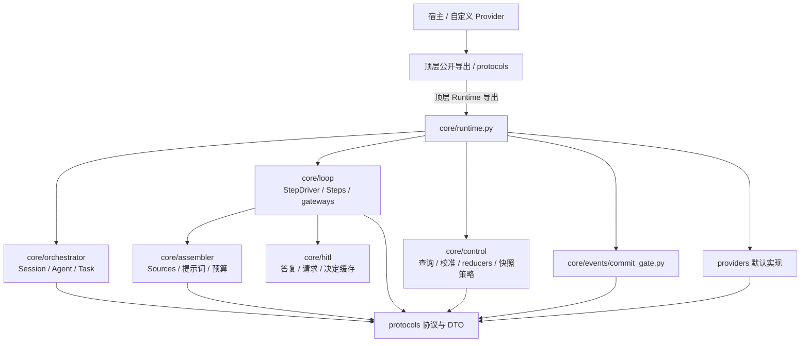
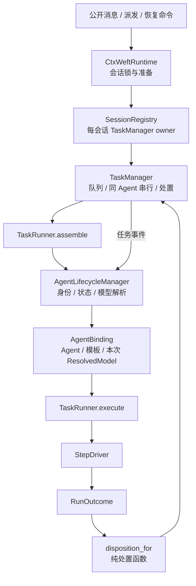
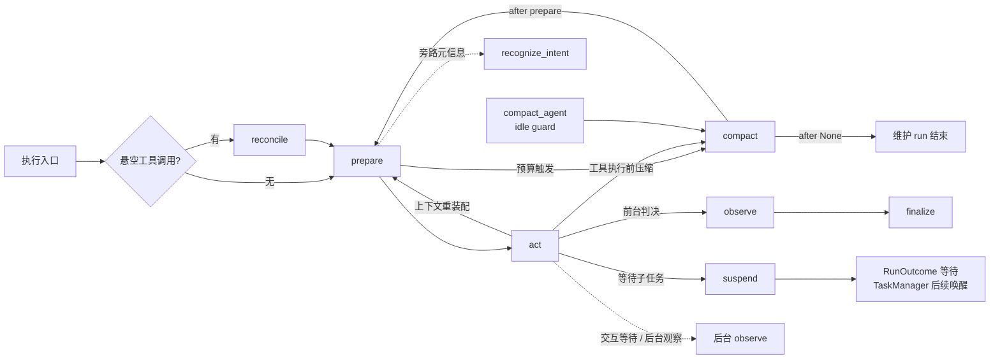
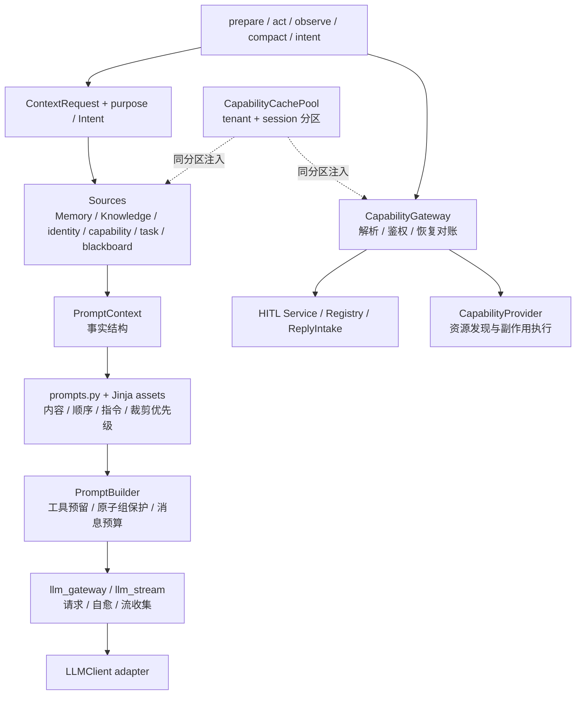
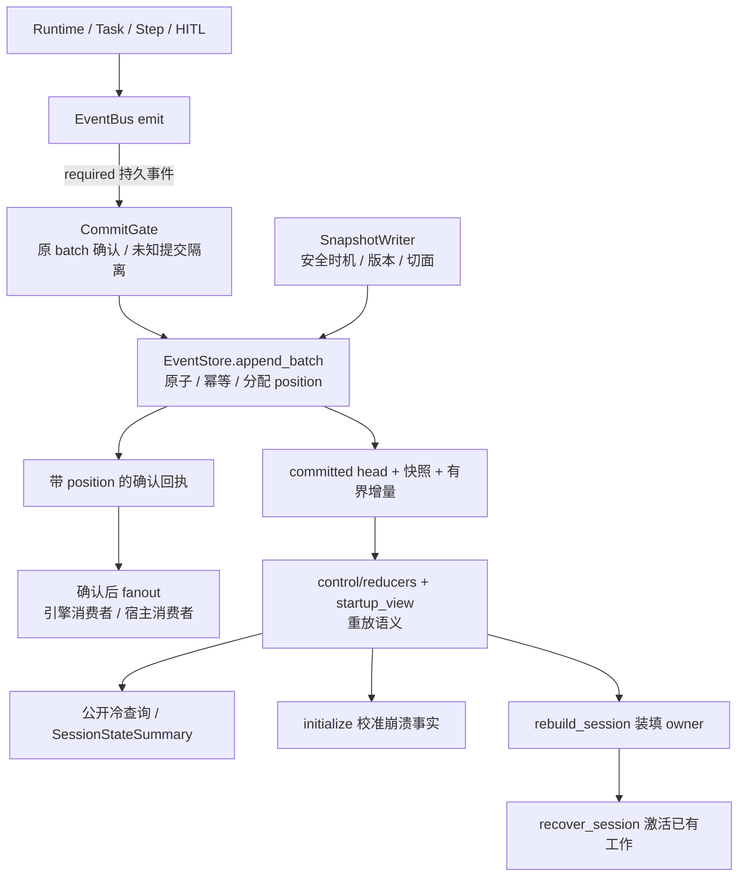

# ctx-weft 模块架构与依赖图

> 核对日期：2026-11-17，以当前工作区为准，包括未提交的能力缓存分区与上下文描述改动。
> 职责及回归索引见 [ARCHITECTURE.md](../ARCHITECTURE.md)，公开使用见 [README.md](../README.md)。本文是图解导航，不增加 SDK 契约。

箭头在每节注明含义。图中 Netlive 是宿主示例；引擎不拥有 HTTP/SSE、聊天路由、用户/Cowork 权限和产品展示状态。

## 1. 模块与协议依赖

下图是主要源码依赖方向，省略同层内部引用。`core/runtime.py` 是引擎装配入口，可以引用默认 Provider；Provider 只允许边界测试中列明的纯工具例外，不能反向引用调度和恢复域逻辑。

图中的“顶层公开导出”和下层 protocols 是同一公开接入面的不同角色：顶层导出实现入口，protocols 定义独立契约。`protocols/` 不导入 core；不是由 protocols 反向构造实现。

| 模块 | 内部结构／所有权 | 稳定交接点 |
| --- | --- | --- |
| Runtime / Registry | 会话锁、实例生命周期、依赖接线；Memory 单实例、能力集合、Knowledge、LLM resolver、blob stores | 公开命令、QueryResult、初始化／关闭报告 |
| orchestrator/lifecycle | SessionRegistry、AgentLifecycleManager、template_lookup、ModelChoice / ResolvedModel | AgentBinding，Agent 身份和模型选择 |
| orchestrator/task | manager、queue、runner、disposition、hooks、failure_threshold | RunOutcome → 纯处置函数 → TaskManager 应用 |
| loop | driver、ExecutionRegistry、八个 Steps、LLM/capability gateway、回合提交、HITL waiter | LoopState/Context、StepOutcome、执行控制令牌 |
| assembler | purpose/Intent、Sources、PromptContext、Jinja、PromptBuilder | 事实与预算后的合法 LLMRequest 输入 |
| capabilities / hitl | 能力解析与缓存、控制工具、鉴权／人工等待 | ProviderContext、RecoveryPolicy、HITL 请求与答复协议 |
| control / events | reducers、startup、session_queries、SnapshotWriter、CommitGate | committed position、快照切面、原 batch 确认 |
| providers | Memory、事件存储／总线、LLM adapters、模板、Skill、工具、blob 等默认实现 | protocols；执行 I/O，不另定调度／恢复政策 |

证据：`tests/unit/test_public_exports.py`、`test_protocols_imports.py`、`test_provider_layer_boundary.py`。依赖例外以该边界测试为准，不复制白名单到图里。

## 2. 任务编排与 Agent 的交接

下图是调用和结果数据流，不是 import 图。

TaskManager 拥有任务状态落地；ALM 拥有 Agent 状态和选择；StepDriver 只执行步骤。`RunFinished` 是执行事实，不能让 TaskManager 再订阅它来启动第二条调度路径。选择与实际模型 client、窗口、输出限制必须来自同一次解析。

同 Agent 串行键和装配归属共用 `effective_agent_id`。新建 instantiate 与恢复 load/materialize 分开；恢复不能重新发创建事件。外部 `send_message` 明确按 Agent 定址，宿主决定聊天产品默认目标。

证据：`tests/unit/test_task_disposition.py`、`test_same_agent_serialization.py`、`test_agent_state_machine.py`、`test_agent_llm_replay.py`。

## 3. Step 引擎内部

下图仅表达主要接续，省略暂停／取消／失败出口及部分重试条件；精确转移以各 Step 和测试为准。当前没有独立 reason Step。

- `LoopState` 传执行数据，`LoopContext` 供依赖和令牌；`StepExecution.options` 是本次调用参数。`StepOutcome.next_step_options` 不自动传给所有后续 Step，也不替代跨步骤 state_patch。
- Act 压缩前已提交但未执行工具的回合保存在 `pending_act_turn`；重入先恢复原调用，不重问模型、不重复记账或副作用。
- Compact 的模型、预算、层级策略归 CompactStep；存储原子整理归 `MemoryProvider.organize`。压缩等待同 Agent 后台 Observe 收尾，不拿等待当取消。
- Observe 前后台共用 Requested → Started → Completed → Applied；Completed 保存已决定结果，Applied 晚于任务处置和报告应用。冷恢复复用原 observe_id 及结果，不能重新判决已完成请求。
- Finalize 管收尾记忆、父 scope、blackboard、TaskFinalized 和 RunOutcome；任务终态仍由 TaskManager 应用。旁路 Intent 不应混入回答流。

证据：`tests/unit/test_compact_step_transitions.py`、`test_compact_wait_observe.py`、`test_observe_lifecycle.py`、`test_observe_recovery_ownership.py`；`tests/integration/test_foreground_observe_interrupt.py`。

## 4. 提示词、能力和 I/O 内部

Source 提供事实，Jinja 表达提示词程序，Python 执行机械预算；不要在 Step、schema、Source 中复制提示词规则。content 协议统一解析与 blob 外部化，预算和渲染工具留 core；内容准备成功不等于事件或任务已提交。

当前缓存按 `(tenant_id, session_id)` 分区，分区内共享控制工具、保存 per-agent 快照及 per-task pin。run 收尾逐出 Agent 快照，task 终结清 pin，会话逐出释放分区。Provider 集合描述读 `describe(ctx).description`；不能从共享属性猜作用域。

Gateway 按逻辑操作身份和已确认结果对账。wire tool_call_id 不是全局执行身份；缺 TOOL_RESULT 也不证明副作用没有执行。工具的资源范围解释归宿主 Provider，通用执行恢复归引擎。

证据：`tests/unit/test_prompt_responsibility_boundaries.py`、`test_prompt_builder.py`、`test_capability_cache_qualified.py`、`test_capability_references.py`、`test_operation_recovery_policy.py`。

## 5. 事件确认与恢复切面

图中的确认保证针对 required 持久事件；瞬态事件和显式 best_effort 策略各有语义，不能把存储失败自动降级为 best_effort。未知提交重试同 batch、同事件封套，不换 ID 或重做副作用。position 才是提交顺序，事件 ID 和时间戳不是恢复游标。

| 入口 | 状态／执行效果 |
| --- | --- |
| 构造 | 同步接线，不扫历史，不恢复 |
| 公开纯查询 | 内存优先、事件回退；不 initialize、不装填、不执行；冷访问显式 session scope |
| initialize | 校准崩溃事实，不装填执行对象、不启动模型；并发共享工作但结果副本独立 |
| rebuild_session | 唯一已有会话装填入口，不 drain |
| recover_session | 明确恢复已有工作；执行前确保初始化和装填 |
| forget_session / purge_session | 前者逐出缓存保历史，后者显式清执行状态；不可混用 |
| close | 停本实例执行并保存可恢复事实，报告失败／超时；外部数据库和 Provider 由宿主关闭 |

reducers 拥有恢复语义和快照版本，SnapshotWriter 拥有写快照政策，Provider 执行存取；不能分别维护版本或判据。完整验证索引复用根架构文档，不在此复制第二份矩阵。

证据：`tests/unit/test_runtime_initialization_queries.py`、`test_ordered_event_store_conformance.py`、`test_read_primitives_conformance.py`；`tests/integration/test_session_lifecycle_forget_rebuild.py`、`test_tool_outcome_not_rerun.py`。

## 6. 修改归属速查

| 需要改变的决定 | 原所有者 |
| --- | --- |
| 哪个任务可运行／重排／等待／终结 | TaskManager + disposition；不在宿主补 Task 状态机 |
| 哪个 Agent／本次用什么模型 | ALM + ModelChoice/ResolvedModel |
| 一步如何推进、前后台与暂停令牌 | StepDriver + 对应 Step |
| 提示词事实、提示词程序、预算 | Sources、Jinja、PromptBuilder 分工修改 |
| 工具身份／执行恢复／人工等待 | CapabilityGateway + HITL；Provider 声明恢复策略并执行操作 |
| 提交是否确认／快照是否可用 | CommitGate、reducers、SnapshotWriter 各自承担原职责 |
| 用户与 Cowork 权限、产品默认路由、HTTP/SSE、展示 | Netlive，不引入本引擎 |

新增需求的详细分级、卡片模板、ADR 与跨仓流程保存在宿主 `docs/change-management.md`。引擎改动仍遵循本仓 AGENTS 和根架构验证表。图随职责和契约变更更新；不按历史 plans 恢复旧模块。
